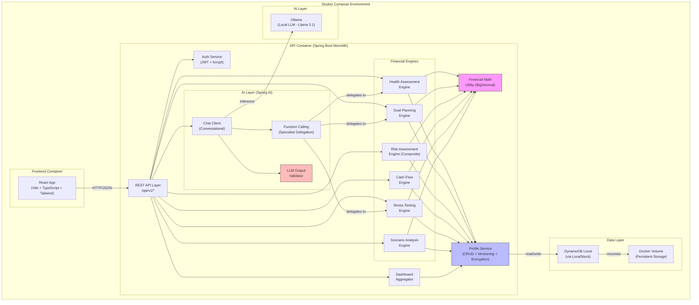
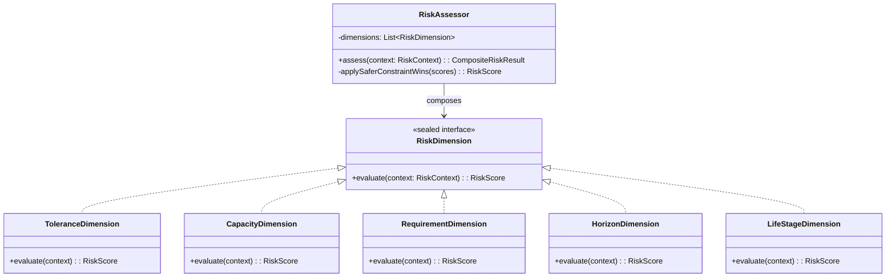
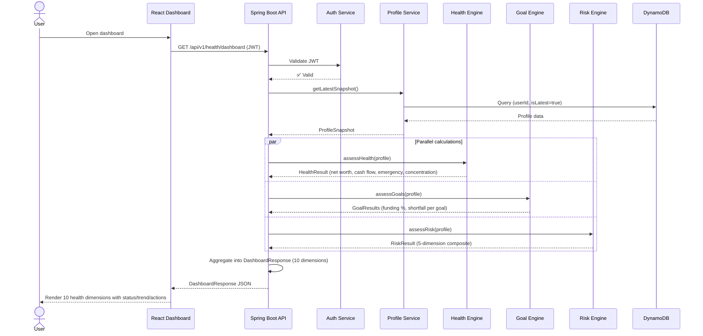
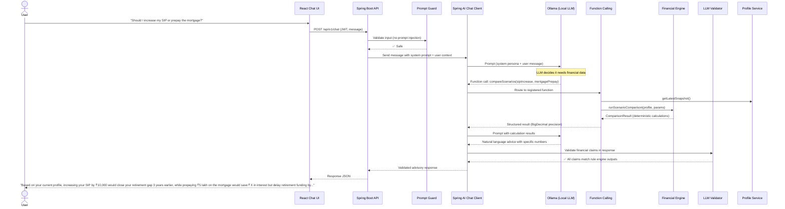
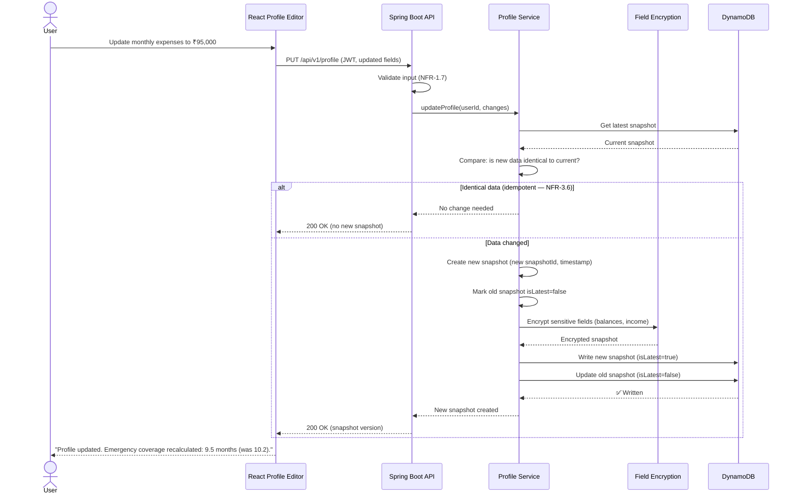
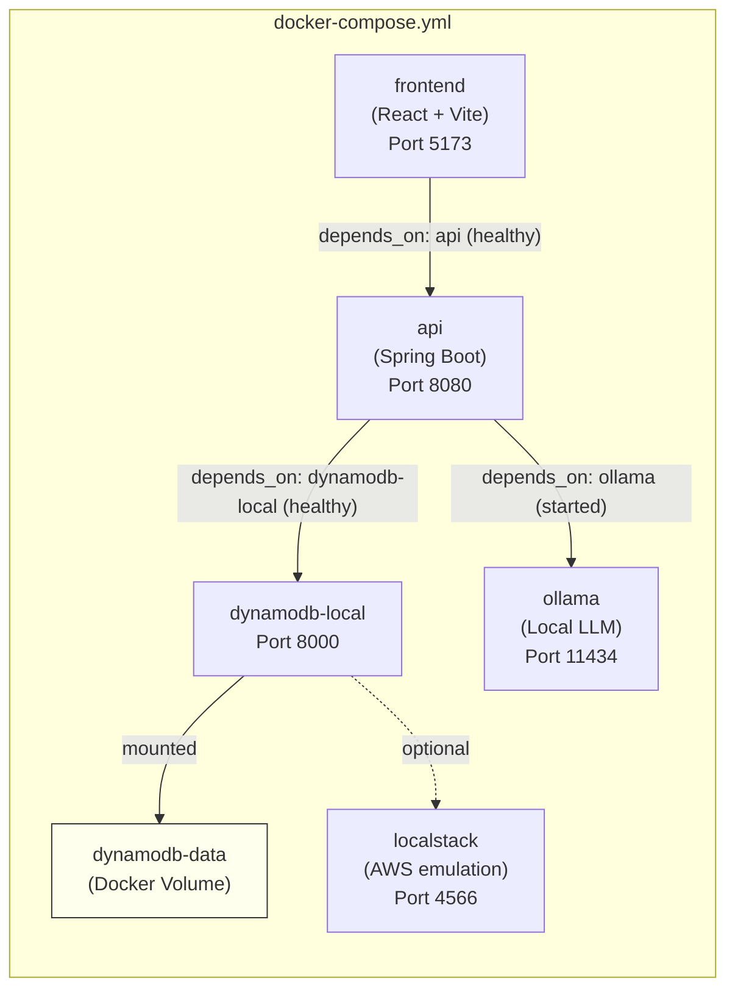

# Personal Financial Advisor (India V1) — Design Document

| Field | Value |
|-------|-------|
| **Version** | 1.0 |
| **Date** | 14 November 2026 |
| **Spec Reference** | [SPEC-v1.md](SPEC-v1.md) (v2.0, locked) |
| **Status** | Draft |

---

## 1. Overview

The Personal Financial Advisor is a private, single-user web application that provides holistic, India-focused financial guidance. It combines a **deterministic Java rule engine** for precise financial calculations with a **Spring AI-powered LLM layer** for natural language interpretation, opinionated advice, and conversational interaction.

The system evaluates the user's complete financial position — assets, liabilities, insurance, goals, risk capacity, behavioural tolerance, and life stage — then delivers clear, evidence-based recommendations through an interactive React dashboard and a conversational chat interface.

**Key design principle:** The product is a financial decision engine, not a stock picker or mutual-fund recommender. Specialist tools (stocks, mutual funds, taxation) support the decision engine; they do not determine household strategy *(per DL-015, FR-11.4)*.

**V1 scope:** Private single-user, India-first (INR, Indian financial products and tax), advisory-only (no trade execution), running locally in Docker Desktop *(per FR-001 to FR-006, DL-001 to DL-003)*.

---

## 2. Background & Context

### Problem Statement

Managing personal finances in India requires balancing multiple interconnected concerns: household cash flow, insurance adequacy, debt management (especially large commitments like home loans), goal-based investing across different time horizons, dynamic risk assessment, and Indian-specific tax optimisation. Available tools tend to be either:

- **Product-focused** (mutual fund platforms, stock screeners) — optimise one dimension in isolation.
- **Generic calculators** — provide formulas without understanding the user's full financial picture.
- **Human advisors** — expensive, inconsistent, and often product-driven.

No tool treats the household's financial life as an integrated system where decisions in one area (e.g., taking a ₹1.8 crore home loan) materially change risk capacity, emergency adequacy, and goal timelines across the board.

### Current State

The user has a defined financial baseline (documented in SPEC §11): age 40, ₹88,000 monthly expenses, ₹9 lakh emergency FD, EPF/MF/stocks/land/gold assets, significant insurance coverage (₹3.5 crore term life), and a major upcoming housing commitment (≈₹2 crore apartment, ≈₹1.8 crore expected mortgage, ≈₹20 lakh furnishing).

Previous financial analysis was done through ad-hoc ChatGPT conversations — useful for individual questions but lacking persistence, consistency, and the ability to maintain a holistic view across sessions.

### Why Now

The housing commitment represents a material inflection point: the ₹1.8 crore mortgage will significantly change cash flow, emergency coverage, and risk capacity. Building a structured advisory system before this commitment ensures decisions are made with full visibility into downstream impacts *(per DL-013, DL-014)*.

### Future Vision

V1 establishes the data model, decision logic, and financial engines. These are designed to be reusable when the system evolves into a cloud-hosted application with richer dashboards, automated data feeds from financial providers, and potentially global/cross-border planning *(per DL-020, Phase Roadmap §14)*.

---

## 3. Goals & Non-Goals

### Goals (V1)

| ID | Goal | Spec Reference |
|----|------|---------------|
| G-1 | Provide a persistent, versioned financial profile that survives across sessions | FR-1.1, FR-1.3, NFR-2.2 |
| G-2 | Calculate financial health across 10 dimensions with correct, reproducible math | FR-2.x, FR-10.2, NFR-3.5 |
| G-3 | Deliver opinionated, evidence-based advice that challenges unsafe choices | FR-12.1, FR-12.2, DL-005 |
| G-4 | Assess risk dynamically per goal and context, not with a static label | FR-4.x, DL-007 |
| G-5 | Stress test the financial plan against adverse scenarios | FR-7.x |
| G-6 | Provide an interactive dashboard with drill-down per health dimension | FR-10.x |
| G-7 | Run entirely locally in Docker Desktop with no cloud dependency | IR-1, Grill decisions |
| G-8 | Use AI/LLM for interpretation and advice while keeping calculations deterministic | FR-12.3, FR-12.4 |

### Non-Goals (Explicitly Out of Scope for V1)

| ID | Non-Goal | Rationale | Spec Reference |
|----|----------|-----------|---------------|
| NG-1 | Automated trade or investment execution | Advisory-only; no transaction risk | FR-003, DL-003 |
| NG-2 | Multi-user or public access | Single private user; multi-user deferred | FR-001, DL-001 |
| NG-3 | Global/cross-border financial planning | India-first; global deferred to Phase 4 | DL-002 |
| NG-4 | Financial independence / early retirement optimisation | Retirement is a goal; FIRE is a separate model | §12 |
| NG-5 | Real-time provider integrations (Groww, Zerodha, MF Central) | Phase 2 scope | DL-006 |
| NG-6 | Risk model numerical calibration | Qualitative framework in V1; quantitative deferred | OD-003 |
| NG-7 | Monte Carlo / probability simulation for goals | Deterministic scenarios in V1; simulation may come later | OD-004 |

---

## 4. Architecture

### 4.1 High-Level Architecture

The system is a **single-process Spring Boot monolith** with a separate React frontend, backed by DynamoDB for persistence and Ollama for local LLM inference *(per §5.1 Architecture Guidance — microservices explicitly rejected)*.



### 4.2 Component Details

#### 4.2.1 API Layer

| Component | Responsibility | Technology | Key Spec Refs |
|-----------|---------------|------------|---------------|
| **REST Controller Layer** | Route HTTP requests, input validation, error formatting | Spring Boot `@RestController`, Bean Validation | NFR-1.7, NFR-5.3, NFR-5.4 |
| **Auth Service** | JWT generation, validation, refresh; password hashing | Spring Security, jjwt, bcrypt | NFR-1.1, NFR-1.5 |
| **CORS Filter** | Restrict cross-origin access to frontend origin | Spring Security CORS config | NFR-1.8 |
| **Actuator** | Health checks for DynamoDB, Ollama, application | Spring Boot Actuator | NFR-5.2 |

#### 4.2.2 Financial Engines

All engines share two core dependencies: **Profile Service** (data access) and **Financial Math Utility** (calculations). Each engine is a Spring `@Service` — no factory pattern, no event bus, direct injection *(per §5.3 Rejected Patterns)*.

| Engine | Responsibility | Key Algorithms | Spec Refs |
|--------|---------------|----------------|-----------|
| **Health Assessment** | Net worth, cash flow surplus, emergency coverage, concentration risk | Liquid/illiquid sum, income-expense diff, coverage ratio | FR-2.x |
| **Goal Planning** | Future value, funding status, shortfall, progress tracking | Compound interest (FV = PV × (1+r)^n), annuity, shortfall | FR-3.x |
| **Risk Assessment** | 5-dimension risk evaluation with composite "safer wins" rule | Tolerance scoring, capacity calc, horizon mapping, composite min | FR-4.x |
| **Cash Flow** | Surplus allocation, EMI impact, spending classification | Income decomposition, allocation optimisation | FR-5.x |
| **Stress Testing** | Income loss, market fall, rate change, large expense scenarios | Parameterised shock models applied to goal projections | FR-7.x |
| **Scenario Analysis** | Side-by-side decision comparison (SIP vs prepay, etc.) | Parallel projection with different parameters | FR-8.x |

#### 4.2.3 Risk Engine — Composite Pattern Detail

The risk engine uses a **sealed interface + composite pattern** *(per §5.2)*:



**Core rule implementation:** `RiskAssessor.applySaferConstraintWins()` takes the minimum (safest) score across all dimensions. If tolerance says "high risk OK" but capacity says "low risk only," the result is "low risk" *(per FR-4.3)*.

#### 4.2.4 AI Advisory Layer (Spring AI)

| Component | Responsibility | Technology | Spec Refs |
|-----------|---------------|------------|-----------|
| **Chat Client** | Conversational financial advice with system prompt persona | Spring AI `ChatClient`, Ollama adapter | FR-12.1, FR-12.5 |
| **Function Calling** | LLM invokes financial engines as tools (specialist delegation) | Spring AI `@Description` functions | FR-11.x, FR-12.3 |
| **LLM Output Validator** | Verify all LLM financial assertions against rule engine | Custom validation service | FR-12.4, EC-4 |
| **Prompt Guard** | Prevent prompt injection from user chat input | Spring AI advisors, system prompt protection | NFR-1.6 |

**Function Calling flow:** When the LLM needs financial data to answer a question, it calls registered functions (e.g., `getFinancialHealth()`, `calculateGoalFunding()`, `runStressTest()`). These functions invoke the Java rule engines, ensuring all numbers come from the deterministic calculation layer — never from LLM generation *(per FR-12.4)*.

#### 4.2.5 Data Layer

| Component | Responsibility | Technology | Spec Refs |
|-----------|---------------|------------|-----------|
| **Profile Service** | CRUD, snapshot versioning, field-level encryption, flexible schema | Spring `@Service`, AWS SDK v2 DynamoDB Enhanced Client | FR-1.x, NFR-2.x |
| **DynamoDB Local** | Persistent storage (via LocalStack) | `amazon/dynamodb-local` in Docker | NFR-2.1 |
| **Docker Volume** | Data persistence across container restarts | Docker named volume | NFR-3.7 |

#### 4.2.6 Frontend

| Component | Responsibility | Technology | Spec Refs |
|-----------|---------------|------------|-----------|
| **Dashboard** | 10-dimension financial health view with drill-down | React + Tailwind, chart library (Recharts or Chart.js) | FR-10.x |
| **Chat Interface** | Conversational advisory UI | React, streaming SSE/WebSocket for LLM responses | FR-12.5 |
| **Profile Editor** | View/edit financial profile data | React forms with validation | FR-1.2 |
| **Scenario Explorer** | Stress test and scenario comparison UI | React, interactive parameter controls | FR-7.x, FR-8.x |

### 4.3 Data Flow

#### 4.3.1 Dashboard Load Flow



#### 4.3.2 Chat Advisory Flow



#### 4.3.3 Profile Update Flow (Snapshot Versioning)



---

## 5. Detailed Design

### 5.1 Processing Logic — Financial Calculations

All financial calculations use `BigDecimal` with `RoundingMode.HALF_UP` and scale 2 for final INR amounts *(per NFR-3.5)*. The **Financial Math Utility** class centralises these formulas *(per §5.2 Key Abstractions)*.

#### Core Formulas

| Calculation | Formula | Used By | Spec Ref |
|-------------|---------|---------|----------|
| **Future Value** | FV = PV × (1 + r)^n | Goal Planning, Scenario Analysis | FR-3.1 |
| **Present Value** | PV = FV / (1 + r)^n | Goal shortfall assessment | FR-3.2 |
| **Future Value of Annuity** | FVA = PMT × [(1+r)^n - 1] / r | SIP projections, contribution planning | FR-3.3 |
| **Required Monthly Contribution** | PMT = (FV - PV×(1+r)^n) × r / [(1+r)^n - 1] | Goal shortfall → required SIP | FR-3.3 |
| **Net Worth** | Σ(assets) - Σ(liabilities), with liquid/illiquid split | Health Assessment | FR-2.1 |
| **Cash Flow Surplus** | Income - (Expenses + EMIs + Insurance + Investments) | Cash Flow Engine | FR-2.2 |
| **Emergency Coverage** | Emergency assets ÷ Mandatory monthly expenditure | Health Assessment | FR-2.3 |
| **Goal Funding %** | (Current tagged assets + PV of future contributions) / Required FV × 100 | Goal Planning | FR-3.2 |

#### Strict Data Validation Pattern

Every engine method follows this pattern *(per NFR-3.1, NFR-3.2)*:

```
1. Receive request with required field list
2. Check profile for each required field
3. If ANY required field is null/missing:
   → Return INSUFFICIENT_DATA error with list of missing fields
   → Do NOT proceed with partial data
   → Do NOT substitute defaults or assumptions
4. Check data freshness (staleness threshold per NFR-6.2)
5. If ANY data is stale:
   → Return STALE_DATA warning with stale fields and their last-updated dates
6. Proceed with calculation using verified data
```

#### Double-Counting Prevention

Asset allocation enforces mutual exclusivity *(per FR-3.7, EC-6)*:

- Each asset has exactly one `goalTag` at any point in time.
- `locked: true` assets (e.g., emergency FD) are excluded from investment pool calculations *(per FR-6.4)*.
- Reallocation requires explicit user action — the system never auto-reassigns assets.
- On any calculation that sums "investable capital," the engine filters out `locked` and `goalTag`-assigned assets.

#### Emergency Fund Protection

The emergency fund threshold defaults to 6 months of mandatory expenses *(per EC-3)*:

```
emergency_months = emergency_assets / mandatory_monthly_expenditure
threshold = EMERGENCY_MONTHS_THRESHOLD (default: 6)

If a recommendation would reduce emergency_assets such that:
  emergency_months_after < threshold
→ Block the recommendation (EC-3)
→ Return: "This action would reduce emergency coverage from X months to Y months, below the safe threshold of Z months."
```

### 5.2 API Design

API endpoints are documented in SPEC §4.2. Key design decisions for implementation:

| Concern | Decision | Rationale |
|---------|----------|-----------|
| **Versioning** | Path prefix `/api/v1/` | Low cost, future-proof *(NFR-5.4)* |
| **Auth** | JWT Bearer token in `Authorization` header | Standard, stateless *(NFR-1.1)* |
| **Error format** | Consistent JSON: `{ error, message, details, timestamp }` | Frontend reliability *(NFR-5.3)* |
| **Content type** | `application/json` for all endpoints | Standard REST |
| **Chat streaming** | Server-Sent Events (SSE) for `/api/v1/chat` | LLM responses stream incrementally; SSE is simpler than WebSocket for one-directional streaming |
| **Pagination** | Cursor-based for `/api/v1/profile/history` | DynamoDB-native, no offset issues |

### 5.3 Data Model

#### DynamoDB Table Design

The system uses a **single-table design** with a composite key:

| Attribute | Type | Description |
|-----------|------|-------------|
| `PK` | String | Partition key: `USER#<userId>` |
| `SK` | String | Sort key: `SNAPSHOT#<snapshotId>` (ULID for chronological ordering) |
| `isLatest` | Boolean | `true` for the current active snapshot |
| `snapshotDate` | String (ISO-8601) | When this snapshot was created |
| `data` | Map | The full profile data (flexible schema) |
| `encryptedFields` | List | Names of fields that are field-level encrypted |

**Access patterns:**

| Pattern | Query | Used By |
|---------|-------|---------|
| Get latest snapshot | PK = `USER#<id>`, filter `isLatest = true` | All engines |
| Get snapshot history | PK = `USER#<id>`, SK begins_with `SNAPSHOT#` | Profile history, trend analysis |
| Get snapshot at date | PK = `USER#<id>`, SK <= `SNAPSHOT#<dateUlid>`, limit 1, reverse | Point-in-time queries |

**GSI (Global Secondary Index):**

| GSI | PK | SK | Purpose |
|-----|----|----|---------|
| `LatestSnapshotIndex` | `userId` | `isLatest` | Fast lookup of current state without scanning |

#### Field-Level Encryption

Sensitive fields are encrypted before storage using AES-256 with a per-field IV *(per NFR-1.2)*:

| Field Category | Example Fields | Encrypted? |
|---|---|---|
| Financial amounts | `assets.*.value`, `income.monthlySalary`, `liabilities.*.principal` | ✅ Yes |
| Insurance details | `insurance.*.cover`, `insurance.*.premium` | ✅ Yes |
| Personal identifiers | Not stored *(NFR-1.3)* | N/A |
| Goal metadata | `goals.*.name`, `goals.*.targetDate` | ❌ No (not sensitive) |
| Risk profile | `riskProfile.behaviouralTolerance` | ❌ No (categorical, not financial) |

---

## 6. Infrastructure

### 6.1 Docker Compose Architecture

All services run via a single `docker-compose.yml` with health checks and dependency ordering *(per IR-1, NFR-5.5)*.



**Startup ordering** *(per NFR-5.5)*:
1. `dynamodb-local` + `ollama` start first (no dependencies)
2. `api` waits for `dynamodb-local` health check (HTTP 200 on port 8000) and `ollama` started
3. `frontend` waits for `api` health check (`/actuator/health` returns UP)

### 6.2 Configuration

All configuration is via environment variables in a `.env` file *(per IR-4)*:

| Variable | Default | Description | Spec Ref |
|----------|---------|-------------|----------|
| `DYNAMODB_ENDPOINT` | `http://dynamodb-local:8000` | DynamoDB connection | IR-2 |
| `OLLAMA_BASE_URL` | `http://ollama:11434` | Ollama API endpoint | IR-3 |
| `LLM_MODEL` | `llama3.1:8b` | Default LLM model | IR-3 |
| `LLM_PROVIDER` | `ollama` | LLM provider (ollama / openai / anthropic) | Grill |
| `LLM_TIMEOUT_SECONDS` | `30` | Timeout for LLM API calls | NFR-3.4 |
| `JWT_SECRET` | *(generated)* | JWT signing key | NFR-1.1 |
| `JWT_EXPIRY_MINUTES` | `60` | Token expiry | NFR-1.1 |
| `ENCRYPTION_KEY` | *(generated)* | AES-256 key for field-level encryption | NFR-1.2 |
| `PASSWORD_HASH_ALGORITHM` | `bcrypt` | Password hashing algorithm | NFR-1.5 |
| `BCRYPT_COST_FACTOR` | `12` | bcrypt cost factor | NFR-1.5 |
| `CORS_ALLOWED_ORIGINS` | `http://localhost:5173` | Allowed CORS origins | NFR-1.8 |
| `STALENESS_THRESHOLD_DAYS` | `7` | Data freshness threshold | NFR-6.2 |
| `EMERGENCY_MONTHS_THRESHOLD` | `6` | Minimum emergency months | EC-3 |
| `FINANCIAL_ROUNDING_MODE` | `HALF_UP` | BigDecimal rounding | NFR-3.5 |
| `FINANCIAL_SCALE` | `2` | Decimal places for INR | NFR-3.5 |

### 6.3 Local Development Setup

```bash
# First-time setup
git clone <repo-url>
cd FinancialAdvisor
cp .env.example .env          # Edit secrets
docker-compose up -d           # Start all services

# Ollama pulls the model on first run (may take several minutes)
# API waits and operates in rule-engine-only mode until model is ready (NFR-3.8)

# Access points:
# Dashboard:  http://localhost:5173
# API:        http://localhost:8080/api/v1/
# Health:     http://localhost:8080/actuator/health
# DynamoDB:   http://localhost:8000
# Ollama:     http://localhost:11434
```

### 6.4 CI/CD

**V1:** Local builds only. Maven/Gradle for backend, npm for frontend *(per Grill — cicd)*.

**Future:** GitHub Actions pipeline:
1. `mvn test` — unit tests (no infra dependency)
2. `docker-compose up -d` — start dependencies
3. Integration tests against LocalStack + DynamoDB Local
4. `docker build` — create application images
5. Push to container registry

---

## 7. Security

### 7.1 Authentication & Authorization

| Layer | Mechanism | Detail | Spec Ref |
|-------|-----------|--------|----------|
| **Password storage** | bcrypt (cost 12) or Argon2id | Passwords hashed before storage; plaintext never stored or logged | NFR-1.5 |
| **Authentication** | JWT Bearer token | Issued on login, included in `Authorization` header for all API calls | NFR-1.1 |
| **Token lifecycle** | 60-minute expiry + refresh endpoint | `/api/v1/auth/refresh` issues new token before expiry | NFR-1.1 |
| **Authorization** | Single-user V1 — all authenticated requests are authorized | Multi-user role-based access deferred to future phase | FR-1.4 |

### 7.2 Data Protection

| Protection | Scope | Implementation | Spec Ref |
|-----------|-------|----------------|----------|
| **Encryption at rest** | All DynamoDB data | DynamoDB Local encryption (LocalStack); cloud DynamoDB uses AWS-managed keys | NFR-1.2 |
| **Encryption in transit** | All API communication | TLS for all HTTP endpoints (HTTPS in production; HTTP acceptable for local Docker) | NFR-1.2 |
| **Field-level encryption** | Financial amounts, income, insurance values | AES-256 with per-field IV, encrypted before DynamoDB write, decrypted on read | NFR-1.2 |
| **Excluded data** | PAN, Aadhaar, OTPs, passwords, broker credentials, full bank account numbers | Never stored in profile — the planning engine needs balances and attributes, not identity secrets | NFR-1.3 |
| **Secret management** | JWT secret, encryption key | `.env` file for local Docker; AWS Secrets Manager for cloud deployment | NFR-1.9 |

### 7.3 LLM Security

| Threat | Mitigation | Spec Ref |
|--------|-----------|----------|
| **Prompt injection** | System prompts protected from user override; Spring AI advisors enforce persona boundaries; user input sanitised before inclusion in prompts | NFR-1.6 |
| **Data leakage to LLM** | Ollama runs locally — no financial data leaves the machine. Cloud LLM option (production) requires explicit opt-in and awareness that data is sent externally. | Grill — llm_strategy |
| **LLM hallucination** | Rule engine validates all financial assertions. LLM cannot fabricate products, returns, or tax rules. Unverifiable claims are stripped or flagged. | FR-12.4, EC-4 |
| **LLM unavailability** | Graceful fallback to rule-engine-only output with user notice | NFR-3.3, NFR-3.4 |

### 7.4 Input Validation

All API inputs are validated at the controller layer before reaching business logic *(per NFR-1.7)*:

| Validation | Rule | Error Code |
|-----------|------|-----------|
| Financial amounts | Non-negative `BigDecimal` | `VALIDATION_ERROR` |
| Dates | Valid ISO-8601, not in the far future | `VALIDATION_ERROR` |
| String fields | Max length, no script injection | `VALIDATION_ERROR` |
| Enum fields | Must match allowed values (e.g., risk tolerance) | `VALIDATION_ERROR` |
| JWT token | Valid signature, not expired | `UNAUTHORIZED` |

---

## 8. Observability

### 8.1 Logging

Structured JSON logging via SLF4J + Logback *(per NFR-5.1)*:

| Log Category | What Is Logged | What Is NOT Logged |
|---|---|---|
| **Financial calculations** | Engine name, input parameter names, result summary (e.g., "net worth: ₹XX lakh") | Raw account balances, income figures, individual asset values |
| **API requests** | Method, path, response code, duration | Request/response bodies with financial data |
| **Auth events** | Login attempts (success/failure), token refresh, token expiry | Passwords, JWT secrets |
| **LLM interactions** | Model used, latency, token count, function calls made | Full prompt content (may contain financial context) |
| **Errors** | Full stack trace, error code, context | Sensitive field values in error context |

### 8.2 Health Checks

Spring Boot Actuator at `/actuator/health` *(per NFR-5.2)*:

| Check | Method | Healthy | Unhealthy |
|-------|--------|---------|-----------|
| **Application** | Built-in | UP | Any startup failure |
| **DynamoDB** | Attempt `describeTable` on profile table | UP | Connection refused or timeout |
| **Ollama** | HTTP GET to `/api/tags` (list models) | UP (model loaded) | Connection refused or model not found |

When Ollama is unhealthy, the application remains UP but operates in rule-engine-only mode *(per NFR-3.8)*.

---

## 9. Deployment

### 9.1 Environments

| Environment | Purpose | LLM | Database |
|---|---|---|---|
| **Local (V1)** | Development and daily use | Ollama (local) | DynamoDB Local (Docker volume) |
| **Cloud (Future)** | Production deployment | Configurable (Ollama/OpenAI/Anthropic) | DynamoDB (AWS managed) |

### 9.2 Local Deployment

Single command: `docker-compose up -d`

**First-run experience:**
1. Docker pulls images (~2-5 minutes depending on network)
2. DynamoDB Local starts and table is auto-created via init script
3. Ollama starts and begins pulling the configured model (may take 10-30 minutes for first model download)
4. Spring Boot API starts, checks health of dependencies
5. API operates in rule-engine-only mode until Ollama model is ready *(per NFR-3.8)*
6. React frontend builds and becomes available at `http://localhost:5173`
7. Full system operational when `/actuator/health` shows all UP

### 9.3 Development Phases (Build Order)

| Phase | Description | Depends On | Spec Refs |
|-------|-------------|------------|-----------|
| **DP-1: Foundation** | Project scaffold, Docker Compose, DynamoDB tables, JWT auth, CORS, API versioning, structured logging, Actuator, error format | — | IR-1 to IR-5, NFR-1.1, NFR-1.5, NFR-1.8, NFR-5.x |
| **DP-2: Profile Engine** | Profile CRUD, snapshot versioning, flexible schema, field encryption, input validation | DP-1 | FR-1.x, NFR-1.2, NFR-1.7, NFR-2.x, NFR-3.6 |
| **DP-3: Financial Calculations** | All 6 engines + Financial Math utility + strict validation | DP-2 | FR-2.x to FR-5.x, NFR-3.5 |
| **DP-4: Stress & Scenario** | Stress testing + scenario comparison | DP-3 | FR-7.x, FR-8.x |
| **DP-5: AI Advisory Layer** | Spring AI + Ollama + chat + function calling + validation + prompt guard | DP-3 | FR-11.x, FR-12.x, NFR-1.6, NFR-3.3, NFR-3.4 |
| **DP-6: Dashboard & Frontend** | React dashboard (10 dimensions), chat UI, profile editor, scenario explorer | DP-3, DP-4 | FR-10.x |
| **DP-7: Integration & Polish** | End-to-end tests, golden files, periodic review, drift detection | DP-1 to DP-6 | FR-9.x, Test Plan |

---

## 10. Decisions Log

All decisions made during spec creation and design, with rationale and spec traceability.

### Discovery Decisions (DL-001 to DL-020)

| # | Decision | Rationale | Spec Ref |
|---|----------|-----------|----------|
| DL-001 | Single-user private product | Avoid premature multi-user complexity | FR-1.4 |
| DL-002 | India-first scope | Immediate value; global deferred to Phase 4 | FR-1.5 |
| DL-003 | Advisory-only (no execution) | Focus on decision quality, avoid transaction risk | §12 Out of Scope |
| DL-004 | Persistent structured profile | Financial data needs reliable updates, history, auditability | FR-1.1, NFR-2.1 |
| DL-005 | Opinionated adviser behaviour | User wants guidance, not neutral options | FR-12.1, FR-12.2 |
| DL-006 | No forced goal priority labels | Quantified shortfalls and trade-offs > arbitrary labels | FR-3.5 |
| DL-007 | Dynamic risk model | Risk changes with age, income, goals, circumstances | FR-4.1, FR-4.4 |
| DL-008 | Balance growth and certainty | Neither max-risk growth nor over-conservative certainty | FR-8.2 |
| DL-009 | Goal-specific risk overrides tolerance | Short-horizon goal money stays low-risk | FR-3.6, FR-4.3 |
| DL-010 | Retirement glide-path, not age-alone | Consider funded status, income, liabilities, surplus wealth | FR-6.3 |
| DL-011 | Emergency fund is protected capital | ₹9L FD not freely investable | FR-6.4 |
| DL-012 | Credit card (paid in full) ≠ debt | Spending mechanism, not revolving debt | FR-5.3 |
| DL-013 | Housing is a major risk driver | ₹2 crore commitment changes liquidity and risk capacity | FR-6.5 |
| DL-014 | Emergency coverage must be dynamic | Recalculate when EMIs or commitments change | FR-2.3 |
| DL-015 | Adviser owns strategy; specialists support | Fund/stock/tax optimisation shouldn't override household strategy | FR-11.4 |
| DL-016 | Specialist data freshness | Require explicit as-of dates for all specialist data | FR-11.5, NFR-6.1 |
| DL-017 | Version financial facts over time | Trend analysis, auditability, history | FR-1.3, NFR-2.2 |
| DL-018 | No sensitive identifiers stored | Planning engine needs balances, not PAN/Aadhaar | NFR-1.3 |
| DL-019 | Dashboard is multidimensional | Single score can hide critical issues | FR-10.1 |
| DL-020 | Preserve requirements for future app | Reuse data model and decision logic | FR-006 |

### Architecture Decisions (Grill + Arch Review)

| # | Decision | Rationale | Spec Ref |
|---|----------|-----------|----------|
| AD-1 | Standalone web app (not ChatGPT plugin) | Full control over UX, persistence, calculations | Grill |
| AD-2 | Docker Desktop for local dev | Zero cloud cost, full control | Grill |
| AD-3 | Java 25 LTS + Spring Boot + Spring AI | Latest LTS, BigDecimal precision, AI integration, AWS ecosystem | Grill |
| AD-4 | React + Vite + TypeScript + Tailwind | Interactive dashboard, fast builds, type safety | Grill |
| AD-5 | DynamoDB Local (via LocalStack) | AWS-native, flexible schema, easy cloud migration | Grill |
| AD-6 | Ollama (local) + cloud LLM option | Privacy for dev, quality option for prod | Grill |
| AD-7 | Hybrid computation (rule engine + LLM) | Deterministic math, AI interpretation | Grill |
| AD-8 | Snapshot-based versioning | Simple, queryable, DynamoDB-friendly | Grill |
| AD-9 | Flexible profile schema | Progressive enrichment, engine handles missing fields | Grill |
| AD-10 | Strict error handling (no assumptions) | Financial adviser must not give false information | Grill |
| AD-11 | JWT auth (future-proof for multi-user) | Security from day one | Grill |
| AD-12 | Golden-file testing (local) | Deterministic validation of financial calculations | Grill |
| AD-13 | Full encryption (at rest + transit + field-level) | Financial-grade security | Grill |
| AD-14 | Monolith (not microservices) | Single user, shared data, no benefit from service separation | Arch Review C-5 |
| AD-15 | No event-driven architecture | Synchronous workflows sufficient | Arch Review C-6 |
| AD-16 | No abstract factory for engines | One implementation per engine, Spring DI is enough | Arch Review C-7 |
| AD-17 | bcrypt/Argon2id for passwords | Industry standard, not plaintext | Arch Review S-1 |
| AD-18 | Prompt injection protection | Adversarial input could bypass financial safety rules | Arch Review S-2 |
| AD-19 | LLM timeout with fallback (30s) | Ollama on local hardware can be slow | Arch Review R-1 |
| AD-20 | BigDecimal HALF_UP, scale 2 | Standard Indian financial rounding | Arch Review R-2 |
| AD-21 | Idempotent snapshot creation | Prevent duplicate history from repeated saves | Arch Review R-3 |
| AD-22 | Docker volume for DynamoDB data | Financial data must survive container restarts | Arch Review R-4 |

---

## 11. Open Questions

Carried from spec §13 (Open Design Decisions). To be resolved during implementation or future phases.

| # | Question | Owner | Status | Target Phase |
|---|----------|-------|--------|-------------|
| OD-001 | Cloud hosting provider and architecture (AWS, GCP, self-hosted) | User | Open | Phase 3 (Dedicated App) |
| OD-002 | Dashboard visual design (exact widgets, charts, layout) | User | Open | DP-6 (Frontend Build) |
| OD-003 | Risk model numerical calibration (thresholds, scoring formulas) | User | Open | DP-3 (Financial Calculations) |
| OD-004 | Goal optimisation method (deterministic only vs add Monte Carlo) | User | Open | Future (post-V1) |
| OD-005 | Education goal assumptions (college type, inflation, timing) | User | Open | DP-3 (Goal Planning) |
| OD-006 | External data providers (Groww, Zerodha, MF Central) | User | Open | Phase 2 (Data Integrations) |
| OD-007 | Global planning (FX, DTAA, multi-jurisdiction) | User | Open | Phase 4 (Global) |
| OD-008 | Spring Boot 4.x vs 3.x — depends on Spring AI compatibility | Agent | Open | DP-1 (Foundation) |
| OD-009 | Chart library for React dashboard (Recharts vs Chart.js vs D3) | Agent | Open | DP-6 (Frontend Build) |

---

## 12. Appendix

### A. Glossary

| Term | Definition |
|------|-----------|
| **EMI** | Equated Monthly Instalment — fixed monthly payment on a loan |
| **EPF** | Employee Provident Fund — mandatory retirement savings in India |
| **FD** | Fixed Deposit — bank savings instrument with guaranteed returns |
| **NAV** | Net Asset Value — per-unit price of a mutual fund |
| **SIP** | Systematic Investment Plan — regular monthly mutual fund investment |
| **DTAA** | Double Tax Avoidance Agreement — treaty between countries to prevent double taxation |
| **AUM** | Assets Under Management — total market value of assets managed by a fund |
| **XIRR** | Extended Internal Rate of Return — annualized return accounting for irregular cash flows |
| **NRI** | Non-Resident Indian — Indian citizen residing abroad (tax implications) |

### B. Spec Traceability Matrix

Every section of this design document traces to specific spec requirements:

| Design Doc Section | Spec Sections |
|---|---|
| §1 Overview | §1 Overview |
| §2 Background | §1, §6 User Profile, §14 Phase Roadmap |
| §3 Goals & Non-Goals | FR-001 to FR-006, §12 Out of Scope |
| §4 Architecture | §5 Architecture Guidance, §7 Tech Stack, FR-12.3 |
| §5 Detailed Design | FR-2 to FR-8, §4.1 Schema, §4.2 API, NFR-3.5 |
| §6 Infrastructure | §10 Infrastructure, IR-1 to IR-5 |
| §7 Security | NFR-1.1 to NFR-1.9 |
| §8 Observability | NFR-5.1 to NFR-5.5 |
| §9 Deployment | §10 Infrastructure, Dev Phases |
| §10 Decisions | DL-001 to DL-020, Grill, Arch Review |
| §11 Open Questions | §13 Open Design Decisions |
